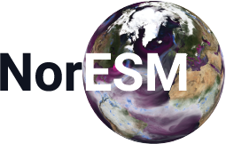

=============================
  NorESM development branch
=============================

This is the main development branch for the Norwegian Earth System Model
(NorESM), currently in development towards the NorESM3.0 release.

* This branch is for technical testing only! It is not a released version
  and results from it should not be used for scientific analysis.

* The component versions in this branch are defined by the git submodules
  listed in **.gitmodules** (see `Obtaining the full model code`_). Each
  submodule is pinned to a tagged version of the NorESM component, via the
  ``fxtag`` entry, consistent with the NorESM3.0 build system.

* Development tags are named ``noresm3_0_betaNN`` (alpha/beta tags) and
  ``noresm3_0_*`` for releases. All changes between tags, including the
  component versions used, are recorded in the **ChangeLog** file.

NorESM is based on the Community Earth System Model (CESM). Information on
the model, usage and contributing is found in:

* NorESM home page: https://www.noresm.org/
* NorESM3.0 user guide: https://noresm-docs.readthedocs.io/en/noresm3.0/index.html
* Contributing guidelines: `CONTRIBUTING.md <CONTRIBUTING.md>`_
* Code of conduct: `CODE_OF_CONDUCT.md <CODE_OF_CONDUCT.md>`_
* Issues and bug reports: https://github.com/NorESMhub/NorESM/issues
* NorESM user mailing list: https://www.noresm.org/mailman/listinfo/users_noresm.org

For background on the underlying CESM framework, see the CESM web site
(https://www.cesm.ucar.edu) and the CIME documentation
(https://esmci.github.io/cime/).

License
=======

NorESM is copyright of the NorESM developers group and is distributed under
the terms given in **LICENSE.txt**. The parts of the code that originate from
CESM are covered by the CESM license in **LICENSE-CESM.txt**. Some NorESM
components have a different license, e.g. BLOM is licensed under the GNU
Lesser General Public License version 3. See **LICENSE.txt** for details; the
license of each component must be obeyed when using, modifying or sharing it.

.. sectnum::

.. contents::

Model components
================

The model is assembled from the following repositories (checked out as
submodules, see **.gitmodules** for the exact versions):

.. list-table::
   :header-rows: 1

   * - Path
     - Component
     - Repository (NorESMhub)
   * - components/cam
     - Atmosphere (CAM-Nor)
     - CAM
   * - components/clm
     - Land (CTSM, incl. FATES)
     - CTSM
   * - components/blom
     - Ocean and ocean biogeochemistry (BLOM/iHAMOCC)
     - BLOM
   * - components/cice
     - Sea ice (CICE6)
     - NorESM_CICE
   * - components/cism
     - Land ice (CISM)
     - CISM-wrapper
   * - components/mosart
     - River routing (MOSART)
     - MOSART
   * - components/ww3
     - Waves (WW3 interface)
     - WW3_interface
   * - components/cmeps
     - Coupler (CMEPS)
     - CMEPS
   * - components/cdeps
     - Data models (CDEPS)
     - CDEPS

Supporting repositories are ``cime``, ``ccs_config`` (machine and compiler
configuration), ``share``, ``libraries/parallelio`` (PIO) and ``tools/statistical_ensemble_test/pyCECT``.

Software requirements
=====================

Software requirements for installing, building and running NorESM
-----------------------------------------------------------------

Installing, building and running NorESM requires:

* a Unix-like operating system (Linux, OS X, etc.)

* git client version 2.25 or newer (needed by git-fleximod)

* python3 version 3.8 or newer

* perl version 5

* build tools gmake and cmake

* Fortran and C compilers

  * See `Details on Fortran compiler versions`_ below for more information

* LAPACK and BLAS libraries

* a NetCDF library version 4.3 or newer built with the same compiler you
  will use for NorESM

  * a PnetCDF library is optional

* a functioning MPI environment (unless you plan to run on a single core
  with the CIME mpi-serial library)

Details on Fortran compiler versions
------------------------------------
The Fortran compiler must support Fortran 2003 features. However, even
among mainstream Fortran compilers that claim to support Fortran 2003,
we have found numerous bugs. Thus, many compiler versions do *not* build
or run NorESM properly. Supported compilers and machines are defined in the
``ccs_config`` submodule.

More details on porting NorESM
------------------------------

For more details on porting NorESM to a new machine, see
https://esmci.github.io/cime/versions/master/html/users_guide/porting-cime.html
and the NorESM user guide.

Obtaining the full model code
=============================

NorESM is distributed via GitHub. To obtain the code do the following:

#. Clone the repository. ::

      git clone https://github.com/NorESMhub/NorESM.git my_noresm_sandbox

   This will create a directory ``my_noresm_sandbox/`` in your current
   working directory.

#. Go into the newly created repository and select the version you want.
   To see which NorESM tags are available, use **git tag**. The development
   branch is checked out by default::

      cd my_noresm_sandbox
      git tag
      git checkout noresm_develop   # or a tag, e.g. noresm3_0_beta30

   (When checking out a tag you will get a message about being in
   'detached HEAD' state. This is normal and expected.)

#. Fetch the components with **git-fleximod**. ::

      ./bin/git-fleximod update

   **git-fleximod** is a package manager that populates the sandbox with
   the relevant versions of each component and the CIME infrastructure,
   as specified in **.gitmodules**.

At this point you have a working version of NorESM.

To see full details of how to set up a case, compile and run, see the
NorESM user guide and the CIME documentation.

More details on git-fleximod
----------------------------

The file **.gitmodules** in your top-level directory tells
**git-fleximod** which version (``fxtag``) of each component should be
brought in to generate your sandbox. The commit recorded by git for each
submodule must be consistent with its ``fxtag``. To check this, use::

  ./bin/git-fleximod status

**You need to rerun** ``./bin/git-fleximod update`` **whenever the
submodule versions have changed**. Common times when this is needed are:

* After checking out a new NorESM branch/tag

* After merging some other NorESM branch/tag into your currently
  checked-out branch

**git-fleximod** should be run from the root of the source tree. To see
more details, issue ::

  ./bin/git-fleximod --help

Customizing your NorESM sandbox
===============================

Switching to a different NorESM tag
-----------------------------------

If you have already checked out a tag and **HAVE NOT MADE ANY
MODIFICATIONS** it is simple to change your sandbox::

  git checkout noresm3_0_beta30
  ./bin/git-fleximod update

You should **not** use this method if you have made any source code
changes, or if you have any ongoing cases that were created from this
sandbox. In these cases, it is often easiest to do a second **git clone**.

Pointing to a different version of a component
----------------------------------------------

Each submodule entry in **.gitmodules** has the following form (we use CAM
as an example)::

  [submodule "cam"]
  path = components/cam
  url = https://github.com/NorESMhub/CAM.git
  fxtag = noresm3_0_057_cam6_4_121
  fxrequired = ToplevelRequired
  fxDONOTUSEurl = https://github.com/NorESMhub/CAM.git

To point to a different version of a component, you can either:

* change into the submodule directory and check out the desired tag or
  branch with git; or

* modify the ``fxtag`` entry in **.gitmodules** and run
  ``./bin/git-fleximod update``.

Keep in mind that changing individual components from a tag may result
in an invalid model (won't compile, won't run, not scientifically
meaningful) and is unsupported.

Committing your change to a component version
~~~~~~~~~~~~~~~~~~~~~~~~~~~~~~~~~~~~~~~~~~~~~

After changing a component version, commit the change in your local git
repository, on a branch, so that the sandbox stays reproducible. For
example::

  git checkout -b my_noresm_branch
  git add .gitmodules components/cam
  git commit -m "Update CAM to noresm3_0_058_cam6_4_121"

Modifying a component
---------------------

If you'd like to modify a component and use your changes in your sandbox
(again using CAM as an example):

#. Fork the component repository (e.g. NorESMhub/CAM) on GitHub and create
   a branch for your development.

#. Point the submodule to your fork and branch, e.g. by changing into
   ``components/cam``, adding your fork as a remote, and checking out your
   branch. Commit the updated submodule hash in the top-level repository.

#. Open a pull request to the relevant NorESM component repository, and
   later a pull request to this repository to update the component version.
   See `CONTRIBUTING.md <CONTRIBUTING.md>`_ and the NorESM user guide.

Developer setup
===============

Developers who have not already done so should follow the recommended
`one-time <https://github.com/esmci/cime/wiki/CIME-Git-Workflow#configure-git-one-time>`_
setup directions for git. Developers may also want to set up
`ssh <https://help.github.com/articles/connecting-to-github-with-ssh/>`_
keys and switch to using the ``git@github.com:NorESMhub/NorESM.git`` form of
the github URLs.

Pull requests to this repository should use the provided issue and pull
request templates, and each new tag should be documented in the **ChangeLog**
(see **ChangeLog_template**).
